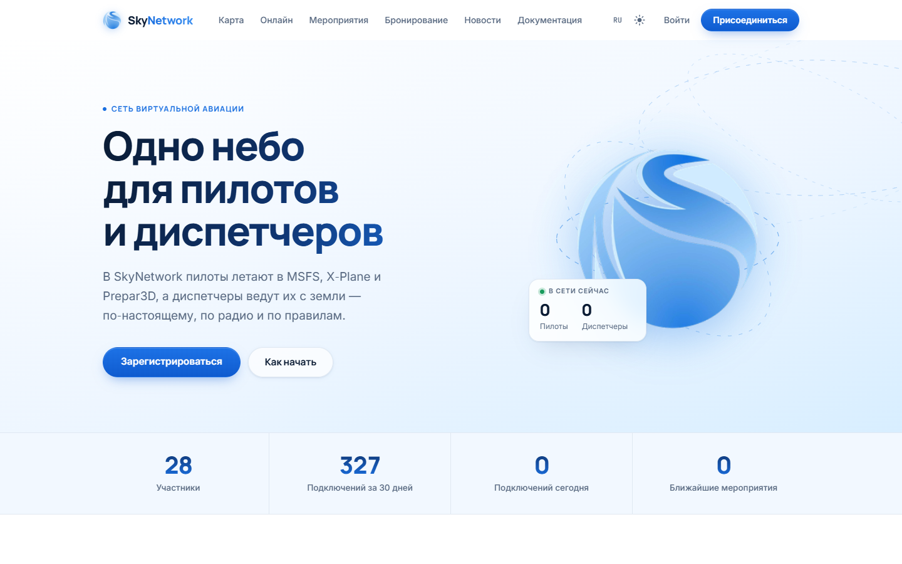
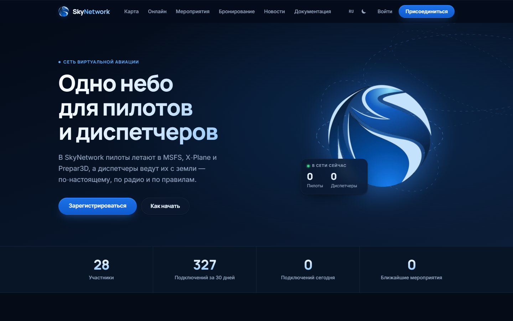

<div align="center">
  
  <h1>SkyRUS&nbsp;— сайт дивизиона</h1>
  <p>Портал русскоязычного дивизиона SkyNetwork: обучение, документы, новости.</p>

  [](https://github.com/chatgpt82628163-pixel/SkyRUS-site/actions/workflows/ci.yml)

  [Сайт](https://skynetwork-skyrus.ru) · [Поддержка](https://sky.network.npzy2.us/support)
</div>

---

## Что это

SkyRUS-site — сайт русскоязычного дивизиона сети SkyNetwork. Он предоставляет участникам дивизиона доступ к учебному центру, нормативным документам и новостям. Вход выполняется через единую систему SkyNetwork Connect, установленную на основном сайте сети, — отдельной регистрации нет.

## Возможности

### Для участников

- **Вход через SkyNetwork Connect** — авторизация через основной сайт сети, без отдельного пароля.
- **Личный кабинет** — статус обучения и рейтинговые заявки участника.
- **Учебный центр** — подача заявки на обучение, просмотр протоколов экзаменов и статуса студента.
- **Разрешения** — список действующих разрешений участника.
- **Документы** — нормативная база дивизиона: НПА и инструкции, организованные по РПИ.
- **Новости** — лента актуальных событий дивизиона.
- **Регионы** — справочник зон ответственности (РПИ) с информацией о каждой.

### Для персонала и администраторов

- **Учебный центр (TC)**: управление студентами и заявками по каждому РПИ, просмотр сводки, ведение протоколов экзаменов.
- **Администрирование**: редактирование документов и шаблонов, публикация новостей (с баннером), управление регионами и составом персонала.
- **Синхронизация рейтингов** — фоновый сервис периодически получает данные рейтинговых заявок от API сети.

## Скриншоты

<div align="center">
  
  <br><br>
  
</div>

## Сборка и запуск

**Требования:** [.NET 8 SDK](https://dotnet.microsoft.com/download) (или новее — проект настроен на `RollForward: Major`).

```bash
# Сборка
dotnet build -c Release

# Тесты
dotnet test -c Release

# Публикация
dotnet publish src/SkyRus.Site -c Release -o publish
```

Запуск в режиме разработки:

```bash
cd src/SkyRus.Site
dotnet run
```

По умолчанию сайт слушает `http://127.0.0.1:8100`.

### Настройка

Конфигурация задаётся в `appsettings.json` или переменными среды (формат `Site__OptionName`):

| Ключ | Описание |
|------|----------|
| `Site:Database` | Путь к SQLite-файлу базы данных (по умолчанию `skyrus.db`). |
| `Site:NetworkUrl` | Адрес основного сайта SkyNetwork (например `https://sky.network.npzy2.us/`). |
| `Site:ConnectClientId` | Идентификатор клиента SkyNetwork Connect. |
| `Site:ConnectClientSecret` | Секрет клиента SkyNetwork Connect. |
| `Site:NetworkApiKey` | Ключ API дивизиона для рейтинговых заявок (`skd_…`). |
| `Site:PublicUrl` | Публичный адрес этого сайта (используется в ссылках в протоколах). |
| `Site:Admins` | CID-ы администраторов через запятую. |
| `Site:BehindProxy` | `true`, если сайт работает за обратным прокси. |

Секреты (ConnectClientSecret, NetworkApiKey) не хранятся в репозитории — передавайте их через переменные среды или `EnvironmentFile` (см. `deploy/skyrus-site.service`).

### Развёртывание

В папке `deploy/` находятся:

- `skyrus-site.service` — unit-файл systemd.
- `install.sh` — первоначальная установка.
- `update.sh` — обновление до новой версии.

## Устройство

```
src/SkyRus.Site/
├── Data/           — работа с SQLite (Dapper), миграции
├── Network/        — клиент API сети SkyNetwork
├── Pages/          — Razor Pages
│   ├── Admin/      — административный раздел (персонал дивизиона)
│   ├── Documents/  — нормативные документы
│   ├── News/       — новости
│   ├── Regions/    — справочник РПИ
│   └── Tc/         — учебный центр
├── Security/       — авторизация, CurrentUser
├── Services/       — TrainingService, SiteContent, RatingRequestSync и др.
├── Program.cs      — точка входа, конфигурация DI и middleware
└── SiteOptions.cs  — параметры секции "Site"
tests/
└── SkyRus.Site.Tests/
deploy/             — скрипты установки и systemd-unit
```

## Часть SkyNetwork

SkyRUS-site — один из репозиториев сети SkyNetwork.

| Репозиторий | Описание |
|-------------|----------|
| [SkyNetwork-site](https://github.com/chatgpt82628163-pixel/SkyNetwork-site) | Основной сайт и портал сети |
| [SkyNetwork-FSD](https://github.com/chatgpt82628163-pixel/SkyNetwork-FSD) | FSD-разработка сети |
| [Network-ATC](https://github.com/chatgpt82628163-pixel/Network-ATC) | Клиент диспетчера |
| [SkyPilot](https://github.com/chatgpt82628163-pixel/SkyPilot) | Клиент пилота |
| [Skynetwork-voice](https://github.com/chatgpt82628163-pixel/Skynetwork-voice) | Голосовая связь |
| [SkyRUS-site](https://github.com/chatgpt82628163-pixel/SkyRUS-site) | Сайт дивизиона SkyRUS (этот репозиторий) |
| [Skynetwork-bot](https://github.com/chatgpt82628163-pixel/Skynetwork-bot) | Бот сети |

---

## English

**SkyRUS-site** is the website of the SkyRUS division of SkyNetwork, live at [skynetwork-skyrus.ru](https://skynetwork-skyrus.ru). It provides division members with access to a training centre, regulatory documents, and news. Authentication is handled through SkyNetwork Connect on the main network site — no separate account is needed.

**Stack:** ASP.NET Core 8 Razor Pages, SQLite (Dapper).

**Build:**

```bash
dotnet build -c Release
dotnet test -c Release
dotnet publish src/SkyRus.Site -c Release -o publish
```

**Configuration** (environment variables or `appsettings.json`, section `Site`): `Database`, `NetworkUrl`, `ConnectClientId`, `ConnectClientSecret`, `NetworkApiKey`, `PublicUrl`, `Admins`, `BehindProxy`. Keep secrets out of source control.

**Deployment:** systemd unit and install/update scripts are in `deploy/`.
